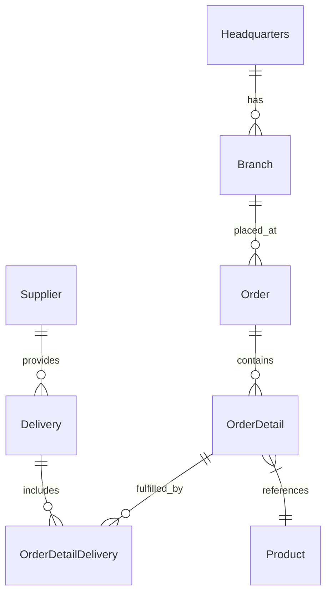

# 🚀 OctoCAT Supply: The Ultimate GitHub Copilot Demo v4.14.0


Welcome to the OctoCAT Supply Website - your go-to demo for showcasing the incredible capabilities of GitHub Copilot, GHAS, and the power of AI-assisted development!

> [!NOTE]
> For a walkthrough of all demos, check out the [Demo Walkthroughs](./demo/walkthroughs/README.md).

## 🏗️ Architecture

The application is built using modern TypeScript with a clean separation of concerns:



### Tech Stack

- **Frontend**: React 18+, TypeScript, Tailwind CSS, Vite

- **Backend**: Express.js, TypeScript, SQLite, OpenAPI/Swagger

- **Data**: SQLite (file db at `api/data/app.db`; in-memory for tests)
- **DevOps**: Docker

## 🚀 Getting Started

### Prerequisites


- Node.js 24+ and npm

- Make

### Quick Start

1. Clone this repository

2. Install dependencies:

   ```bash
   make install
   ```

3. Start the development environment:

   ```bash
   make dev
   ```

This will start both the API server (on port 3000) and the frontend development server (on port 5137).

### Available Make Commands

View all available commands:

```bash
make help
```

Key commands:

- `make dev` - Start both API and frontend development servers
- `make dev-api` - Start only the API server
- `make dev-frontend` - Start only the frontend server
- `make build` - Build both API and frontend for production
- `make db-init` - Initialize database schema
- `make db-seed` - Seed database with sample data
- `make test` - Run all tests
- `make clean` - Clean build artifacts and dependencies

### Database Management

Initialize the database explicitly (migrations + seed):

```bash
make db-init
```

Seed data only:

```bash
make db-seed
```


Or use npm scripts directly in the API directory:

```bash
cd api && npm run db:migrate  # Run migrations only
cd api && npm run db:seed     # Seed data only
```


### VS Code Integration

You can also use VS Code tasks and launch configurations:

- `Cmd/Ctrl + Shift + P` -> `Run Task` -> `Build All`
- Use the Debug panel to run `Start API & Frontend`

## 🛠️ MCP Server Setup (Optional)

To showcase extended capabilities:

1. Install Docker/Podman for the GitHub MCP server
2. Use VS Code command palette:
   - `MCP: List servers` -> `playwright` -> `Start server`
   - `MCP: List servers` -> `github` -> `Start server`
3. Configure with a GitHub PAT (required for GitHub MCP server)

## 📋 Using this template

If you create your own copy of this repository, here's what to expect from the included workflows:

- **CI and CodeQL** run automatically on pushes and pull requests.
- **CodeQL results** require GitHub Code Security on private repositories. If your organization enables CodeQL **default setup**, it conflicts with the template's `codeql-advanced.yml` workflow — disable one or the other.
- **Build and Publish** calls reusable workflows from [`octobooth-demos/octocat-supply-reusable-workflows`](https://github.com/octobooth-demos/octocat-supply-reusable-workflows), pinned to the `v1` tag.
- **Agentic workflows** (daily activity summary on a schedule, build-failure analysis, issue triage, PR doc/tests check) need GitHub Copilot and [gh-aw](https://github.com/github/gh-aw) set up in your own account; without that they fail harmlessly.
- **Deploy to Azure** is dispatched automatically after Build and Publish succeeds on `main`. It only verifies the container image attestations — the Azure deployment step is disabled in this template, so no Azure setup is required. See [docs/deployment.md](docs/deployment.md) if you want to add a real deployment.

## 📚 Documentation

- [Detailed Architecture](./docs/architecture.md)
- [SQLite Integration](./docs/sqlite-integration.md)
- [Complete Demo Script](./demo/walkthroughs/README.md)

Database defaults and env vars:

- DB file: `api/data/app.db` (override with `DB_FILE=/absolute/path/to/file.db`)
- Enable WAL: `DB_ENABLE_WAL=true` (default)
- Foreign keys: `DB_FOREIGN_KEYS=true` (default)

## 🎓 Pro Tips for Solution Engineers

- Practice the demos before customer presentations
- Remember Copilot is non-deterministic - be ready to adapt
- Mix and match demo scenarios based on your audience
- Keep your GitHub PAT handy for MCP demos

## 🛡️ For maintainers

This template intentionally contains vulnerable code, planted secrets (such as `api/ca.key` and the invalidated tokens in the history of `api/.env.example`), and code-quality issues that the booth security demos depend on. They should not be fixed or removed in this template, and Dependabot, autofix, or other pull requests that would remove them should be closed rather than merged.

Demo repositories are created from this template by [octobooth-demos/repo-setup-scripts](https://github.com/octobooth-demos/repo-setup-scripts#readme) (see its [release process](https://github.com/octobooth-demos/repo-setup-scripts/blob/main/docs/releasing.md)). Templates aren't versioned, so changes merged here reach new demos immediately; test a demo run before merging.

Fixing vulnerabilities in a demo repository created from this template is expected — that's the demo.

The Playwright MCP server is only in `.vscode/mcp.json`, not `.mcp.json`, because booth machines can't reach the npm registry and an `npx` server there stalls local Copilot sessions.

---

*This entire project, including the hero image, was created using AI and GitHub Copilot! Even this README was generated by Copilot using the project documentation.* 🤖✨
