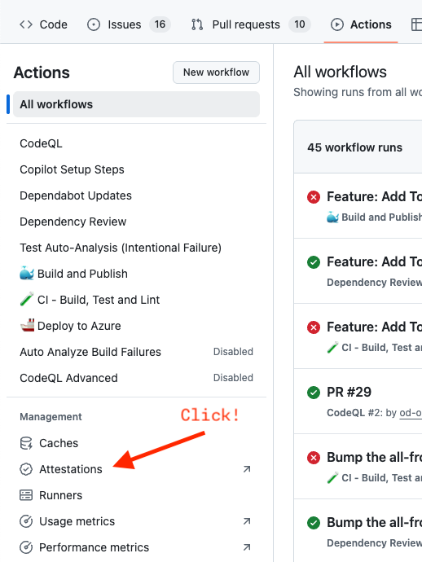
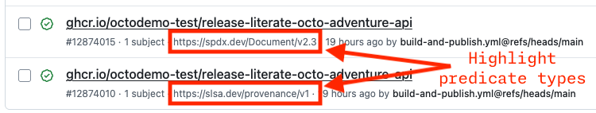
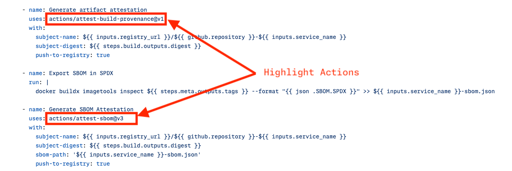
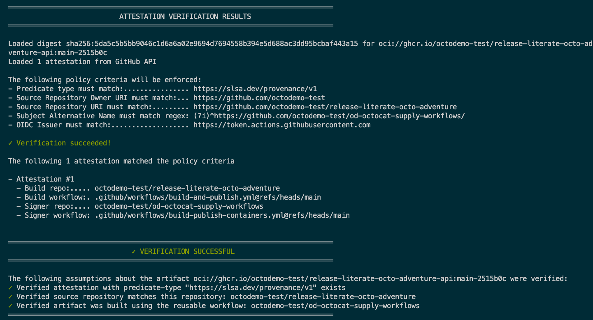
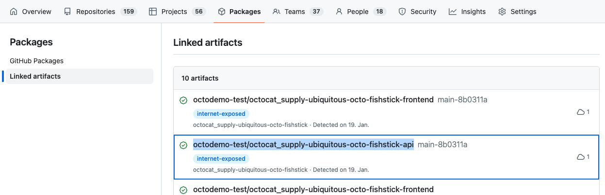
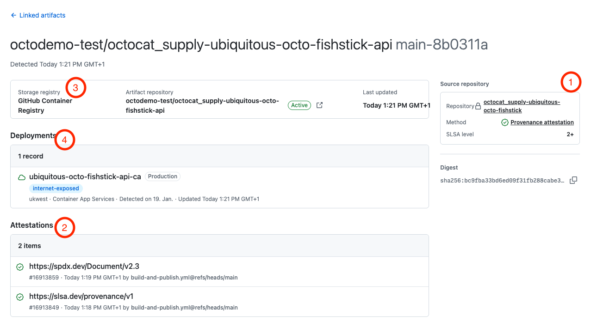

# GitHub Actions Demos

### Required Workflows

- **id**: walkthrough.actions.required-workflows
- **Capabilities:** GitHub Actions, [Required Workflows](../capabilities/actions.md#required-workflows) (`capability.required-workflows`), [Repository Rulesets](../capabilities/governance.md#repository-rulesets) (`capability.repository-rulesets`)
- **Contents:** [Dependency review workflow](../inventory.md) (`content.dependency-review-workflow`)

1. Navigate to the pull request `Feature: Add ToS Download` in the demo repository.
2. Scroll down to the status checks. Point out the **Dependency Review** required workflow — enforced by the [OD OctoCAT Supply Ruleset](https://github.com/organizations/octobooth-demos/settings/rules) (see [governance.md](./governance.md) for more).
3. Navigate to the central workflows repository to show the required workflow definition: https://github.com/octobooth-demos/octocat-supply-reusable-workflows/blob/main/.github/workflows/dependency-review.yml

### Reusable Workflows

- **id**: walkthrough.actions.reusable-workflows
- **Capabilities:** GitHub Actions, [Reusable Workflows](../capabilities/actions.md#reusable-workflows) (`capability.reusable-workflows`)
- **Contents:** [Build and publish workflow](../inventory.md) (`content.build-and-publish-workflow`)

1. In the demo repository, navigate to the **Actions** tab.
2. Select the [Build and Publish](../../.github/workflows/build-and-publish.yml) workflow from the left sidebar.
3. Review the workflow file to see how it references the reusable workflow from the central repository.
4. Navigate to the central repository to view the workflow: https://github.com/octobooth-demos/octocat-supply-reusable-workflows/blob/main/.github/workflows/build-publish-containers.yml

## Artifact Attestations

### Creating the Attestation

- **id**: walkthrough.actions.attestations-create
- **Capabilities:** GitHub Actions, [Artifact Attestations](../capabilities/governance.md#artifact-attestations) (`capability.artifact-attestations`)
- **Contents:** [Attestation workflow](../inventory.md) (`content.attestation-workflow`)


1. In the demo repository, navigate to the **Actions** tab and select **Attestations**.
  
2. You will find at least four attestations (two each for the frontend and API). Focus on the API attestations and their distinct `predicate-types`:

    

    1. `https://spdx.dev/Document/v2.3`: Confirms an SBOM is attached. (Note: This does not validate the SBOM's contents).
    2. `https://slsa.dev/provenance/v1`: Verifies the artifact's origin, confirming it was built by a specific reusable workflow and originated from your demo repository.
3. Return to the [Build and Publish](../../.github/workflows/build-and-publish.yml) workflow (accessible via the `Workflow File` link on the attestation page).
4. Point out that this workflow uses a reusable workflow to generate attestations, and navigate to it: https://github.com/octobooth-demos/octocat-supply-reusable-workflows/blob/main/.github/workflows/build-publish-containers.yml
5. In the reusable workflow, scroll to the bottom to show the simple, built-in actions that generate the attestations.
  

### Verifying the Attestation

- **id**: walkthrough.actions.attestations-verify
- **Capabilities:** GitHub Actions, [Artifact Attestations](../capabilities/governance.md#artifact-attestations) (`capability.artifact-attestations`)
- **Contents:** [Attestation workflow](../inventory.md) (`content.attestation-workflow`)

> [!NOTE]
> The [`./demo/resources/verify-attestation.sh`](../../demo/resources/verify-attestation.sh) script provided in the demo repo automates the generation of the `gh attestation verify` command for easy demoing. It finds the latest container image and runs the appropriate `gh` command. Ensure you are authenticated with the `gh` CLI (`read:packages` scope); the script will guide you if needed.

1. In a local checkout or Codespace, open a terminal.
2. Run the verification script:

    ```bash
    ./demo/resources/verify-attestation.sh
    ```

3. The output will show:
  
    1. The raw output from the `gh attestation verify` command.
    2. A summary explaining the verification results.

4. (Optional) If Azure deployments are configured, show how verification can be enforced in a GitHub Action:
    1. Open the deployment workflow: [.github/workflows/deploy.yml](../../.github/workflows/deploy.yml).
    2. Open the `Verify Container Attestations` step.
    3. Navigate to the custom action's source: [.github/actions/verify-container-attestations/action.yml](../../.github/actions/verify-container-attestations/action.yml).
    4. The `GH_COMMAND` environment variable contains the `gh attestation verify` commands for both SLSA and SBOM checks.
    5. This action also generates a helpful job summary, which you can display by navigating to a successful workflow run.

### Virtual Registry, aka Linked Artifacts

- **id**: walkthrough.actions.virtual-registry
- **Capabilities:** GitHub Packages, [Virtual Registry / Linked Artifacts](../capabilities/governance.md#virtual-registry-linked-artifacts) (`capability.virtual-registry`), GitHub Advanced Security
- **Contents:** [Deploy workflow](../inventory.md) (`content.deploy-workflow`)

> [!IMPORTANT]
> This demo requires you to use the demo option `Requires Azure Deployment` set to `Yes`!

1. After repository creation, wait for the deployment action to complete.
2. Navigate to the [organization's Linked artifacts page](https://github.com/orgs/octobooth-demos/artifacts).

    

3. In the linked artifacts, search for the `api` artifact of your repository:

    ```txt
    octobooth-demos/-api
    ```

4. Review the information on this screen:
    
    1. **Source Repository:** This links this metadata record to the actual source repository. In the demo's case, this is automatically done through the provenance attestation created during the build process (see the [Artifact Attestations](#artifact-attestations) section above).
    2. **Attestations:** A list of all associated attestations is also provided at the bottom of the page.
    3. **Storage Record:** This links the artifact itself to this metadata record.
    4. **Deployments:** This is the main piece. Here, metadata about the deployment of the artifact in production can be added, such as the cluster name, risk metadata (like `internet-exposed`), physical location, etc.

5. Go to the `Organization's Security Page` -> `Alerts (Section Header)` -> `Code Scanning`.
6. Apply the two filters `runtime-risk:internet-exposed` and `severity:high` (optionally, if there are too many results in your demo organization, add a filter for the repository name `repo:octobooth-demos/`).
7. You should see the alert `SQL query built from user-controlled sources` in the list with the `internet-exposed` runtime risk filter applied.
    1. (optional): Use this direct link to the filtered view: <https://github.com/orgs/octobooth-demos/security/alerts/code-scanning?query=is%3Aclosed+runtime-risk%3Ainternet-exposed+severity%3Ahigh++repo%3A>

> [!TIP]
> The **sha256-digest** of the artifact is what connects all of these resources, that is the provenance attestation, the storage recrod and the deployment record, together and allows us to show easily navigate through them.

#### (optional) Show the creation of the Records in the Deployment Workflow

- **Capabilities:** GitHub Actions, [Virtual Registry / Linked Artifacts](../capabilities/governance.md#virtual-registry-linked-artifacts) (`capability.virtual-registry`)
- **Contents:** [Deploy workflow](../inventory.md) (`content.deploy-workflow`)

1. Navigate back to the repository and to the workflow file: [.github/workflows/deploy.yml](../../.github/workflows/deploy.yml).
2. The job `update-virtual-registry` has four steps. Show the two for the API deployment:
    1. **Create API Storage Record**
    2. **Create API Deployment Record**
3. Open both steps and show the `gh cli` command used to create the records in the Virtual Registry.

> [!TIP]
> External tools like Azure Defender for Cloud or Artifactory create these records automatically already today, but under the hood, they use the same REST API the `gh` CLI calls above are using.
