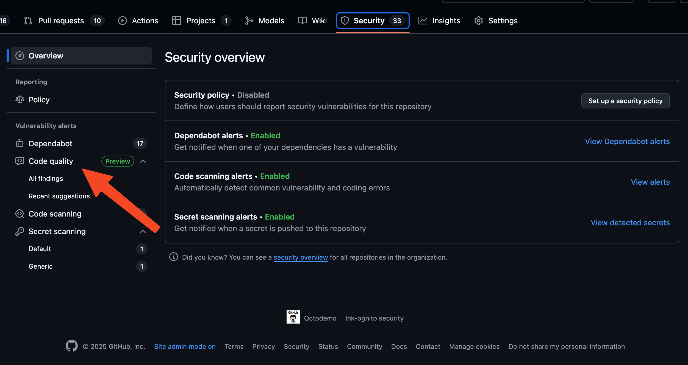
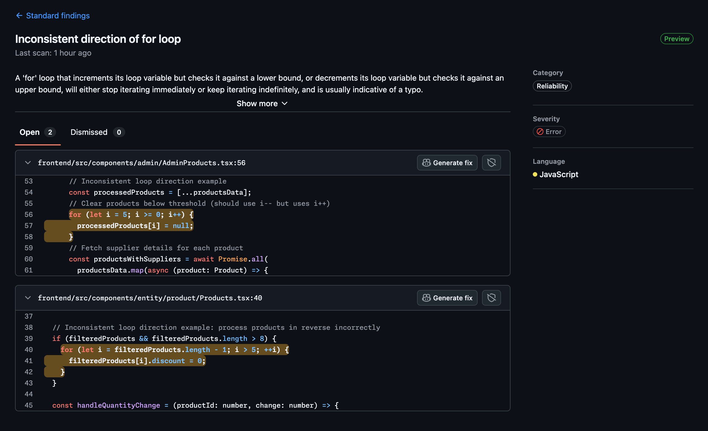
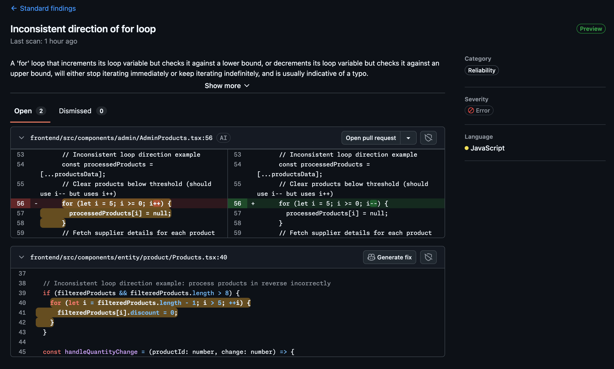
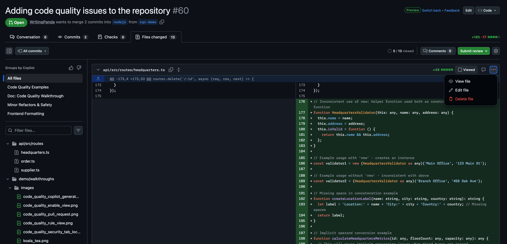
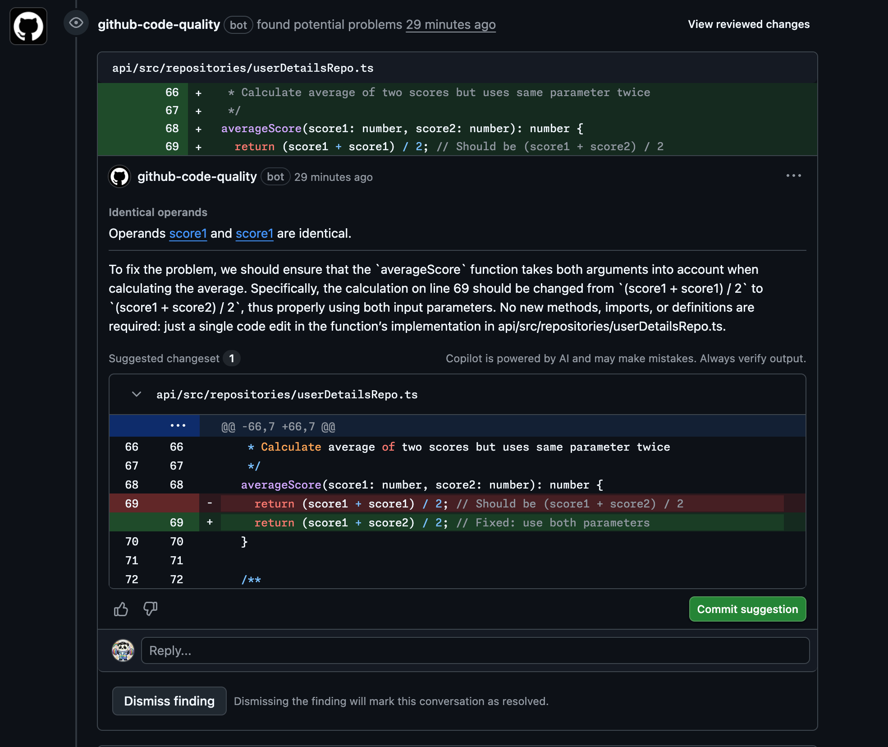

# Code Quality Demo 

### Exploring Repository Code Quality Insights

- **id**: walkthrough.code-quality.insights-repo
- **Capabilities:** [Repository Code Quality Insights](../capabilities/code-quality.md#repository-code-quality-insights) (`capability.code-quality-insights-repo`)
- **Contents:** [Code Quality Insights View](../inventory.md) (`content.code-quality-insights-view`), [Code quality findings (Node.js)](../inventory.md) (`content.code-quality-nodejs`), [Code quality findings (Frontend)](../inventory.md) (`content.code-quality-frontend`)

1. Navigate to the `Security` tab of the repository.
2. In the left sidebar, under `Code Quality`, click `Insights`.
3. Walk through the quality grade shown at the top — explain what the grade means and how it reflects the overall health of the codebase.
4. Review the breakdown by category (e.g., reliability, maintainability, security smells) to highlight where the codebase has the most technical debt.
5. Click on a category to drill into the specific rules and their finding counts.

> [!TIP]
> Pair this with the [Review Code Quality Findings and Generate Fixes with Copilot](#review-code-quality-findings-and-generate-fixes-with-copilot) walkthrough to move from the high-level insights view into individual finding remediation.

### Exploring Organization Code Quality Insights

- **id**: walkthrough.code-quality.insights-org
- **Capabilities:** [Organization Code Quality Insights](../capabilities/code-quality.md#organisation-code-quality-insights) (`capability.code-quality-insights-org`)
- **Contents:** [Code Quality Insights View](../inventory.md) (`content.code-quality-insights-view`)

1. Navigate to the organization page on GitHub.
2. Click on the `Security` tab, then select `Code Quality` from the left sidebar.
3. Show the aggregated quality overview listing all repositories with their grades.
4. Highlight repositories with low grades as examples of where technical debt is highest.
5. Use filters to narrow by language, grade, or team to demonstrate targeted prioritization.
6. Click through to a specific repository's insights page to show how leadership can drill down from the org view to individual codebase details.

> [!TIP]
> Combine with the [Repository Code Quality Insights](#exploring-repository-code-quality-insights) walkthrough to show the full journey from org-level triage to per-repo remediation.

### Review Code Quality Findings and Generate Fixes with Copilot

- **id**: walkthrough.code-quality.findings-and-fixes
- **Capabilities:** [Code Quality](../capabilities/code-quality.md#code-quality) (`capability.code-quality`), [Copilot Autofix](../capabilities/code-scanning.md#copilot-autofix) (`capability.copilot-autofix`)
- **Contents:** [Code quality findings (Node.js)](../inventory.md) (`content.code-quality-nodejs`), [Code quality findings (Python)](../inventory.md) (`content.code-quality-python`), [Code quality findings (Java)](../inventory.md) (`content.code-quality-java`), [Code quality findings (Frontend)](../inventory.md) (`content.code-quality-frontend`)

1. To view the Code Quality results, click on the `Security` tab, then select `All findings` under `Code Quality` from the left sidebar.
  
2. Select any of the finding rules to view a list of findings for that rule.
3. Click on `Show more` to review details of the code quality finding and review the recommentation and examples provided.
4. Click on `Show less` to collapse the view to focus on the findings.
5. The findings will be highlighted, and the next action you can take is to click on the `Generate fix` button to create a fix using Copilot to address the issue. Wait for Copilot to finish creating the fix.
  
6. Once the fix is presented in the UI, you can click `Open pull request` to create a PR with the suggested fix.
  

### Review Code Quality Findings in a Pull Request

- **id**: walkthrough.code-quality.findings-in-pr
- **Capabilities:** [Code Quality](../capabilities/code-quality.md#code-quality) (`capability.code-quality`), Pull request integration
- **Contents:** [ToS Download PR](../inventory.md) (`content.tos-download-pr`), [Code quality findings in ToS PR (Node.js)](../inventory.md) (`content.code-quality-tos-nodejs`), [Code quality findings in ToS PR (Python)](../inventory.md) (`content.code-quality-tos-python`)

1. Navigate to the `Pull requests` tab of your demo repository.
2. Open the pull request `Feature: Add ToS Download`.
3. View the `Files Changed` tab to see the changes made in the PR.
4. Click the ellipsis (`...`) button on the top right side of any of the files changed and click `Edit file`.
5. Add a commented line to that file, and add the changes to the current commit.
  
6. Wait some time for the CI to run Code Quality analysis and upload the results to GitHub. It should take about 1 to 2 minutes.
7. Back in the `Conversation View`, scroll down to the `github-code-quality` bot comment to view the Code Quality findings related to this PR.
  
8. Review the autofix suggestions provided by Copilot in the comment.
9. Show the available options: commit the suggestion to the PR, dismiss the finding, or reply to the autofix.
10. If you do commit the suggestion to the PR, wait for the CI to run and validate the changes.

### Review Code Coverage in a Pull Request

- **id**: walkthrough.code-quality.pr-coverage
- **Capabilities:** [Code Coverage](../capabilities/code-quality.md#code-coverage) (`capability.code-coverage`), Pull request integration
- **Contents:** [Code Coverage CI Workflows](../inventory.md) (`content.code-coverage-ci`)

> [!NOTE]
> Every CI workflow (`ci-nodejs.yml`, `ci-java.yml`, `ci-python.yml`, `ci-php.yml`) generates a Cobertura XML report through test-framework configuration (Vitest, JaCoCo + ReportGenerator conversion, `pytest-cov`, PHPUnit) and uploads it with `actions/upload-code-coverage@v1`. Coverage on pull requests is compared against the baseline from `main`.

1. Navigate to the `Pull requests` tab of your demo repository and open a pull request that changes source code.
2. Wait for the `CI` workflows to finish; each uploads a coverage report labeled `code-coverage/<backend>-api`.
3. In the `Conversation View`, review the code coverage results posted by Code Quality, including the coverage change compared to `main`.
4. Open the `Files changed` tab to see which changed lines are not covered by tests.
5. Discuss how this replaces third-party services (Codecov, Coveralls) and how the `Restrict code coverage` rule can enforce minimum coverage.
