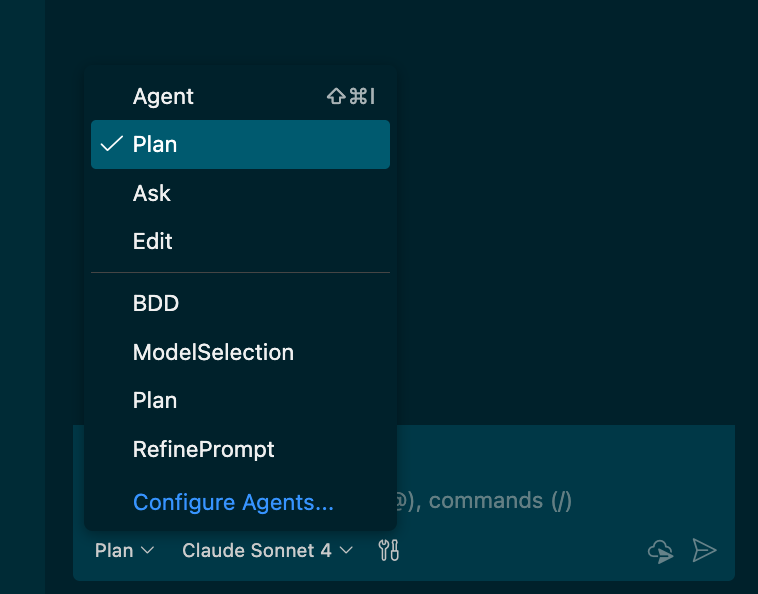
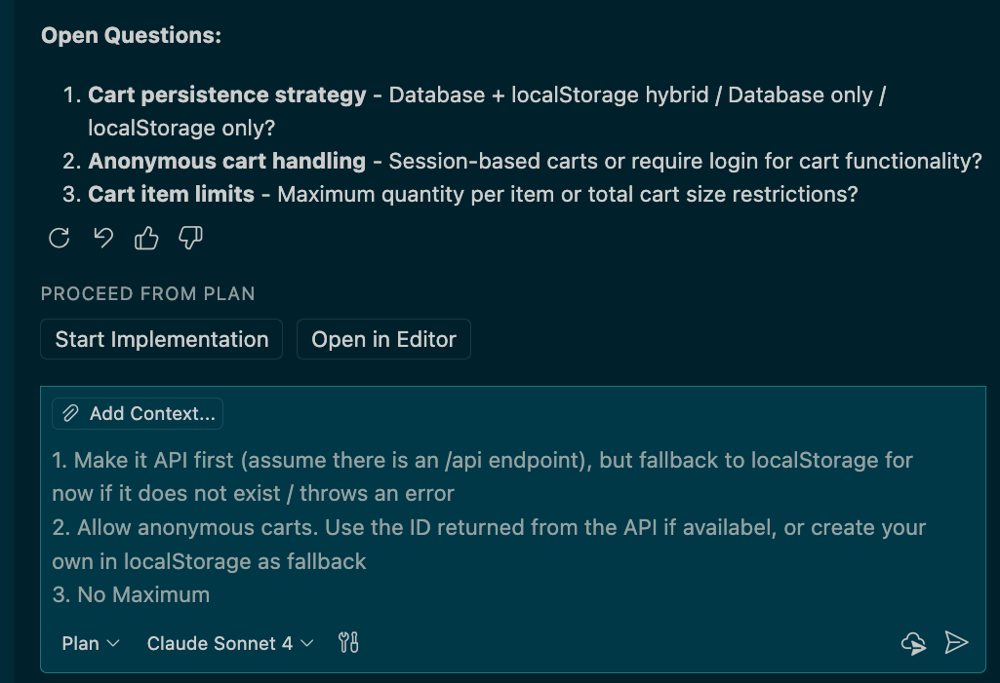
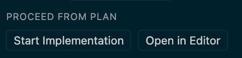

# Copilot in the IDE

> Note: For the most basic "What can Copilot do?" scenario, use the `demo-unit-test-coverage` prompt to have Agent Mode add some unit tests.

## General Copilot Features

### Demo: Enhancing Unit Tests with Coding Agent

- **id**: walkthrough.copilot.unit-test-coding-agent
- **Capabilities:** [Copilot Agent Mode](../../capabilities/copilot-ide.md#copilot-agent-mode) (`capability.copilot-agent-mode`), Copilot in VSCode
- **Contents:** [Improve test coverage for API issue](../../inventory.md) (`content.improve-api-test-coverage-issue`)

1. Open the repo and find Issue #2 (`Improve test coverage for API` — created during demo spinup)
2. Assign the issue to Copilot — that's it. This takes about 15 mins, so do this ahead of time if necessary!

> [!TIP]
> **Using 3rd Party Agents:** When assigning an issue to Copilot, you can open the **Web agents panel** or use the **Agent Picker** in VSCode to select an alternative agent such as **Claude** or **Codex** instead of the default Copilot Cloud Agent. This allows you to leverage different agents for your coding tasks.

### Demo: Live Coding with Custom Prompt

- **id**: walkthrough.copilot.unit-test-custom-prompt
- **Capabilities:** [Copilot Agent Mode](../../capabilities/copilot-ide.md#copilot-agent-mode) (`capability.copilot-agent-mode`), Copilot in VSCode
- **Contents:** [Improve test coverage for API issue](../../inventory.md) (`content.improve-api-test-coverage-issue`), [Demo prompts](../../inventory.md) (`content.demo-prompts`)

1. Open the [demo-unit-test-coverage.prompt.md](../../../.github/prompts/demo-unit-test-coverage.prompt.md) file
2. Show the prompt structure: pre-configured for Agent mode, comprehensive tool list, detailed testing requirements
3. Explain how it includes specific coverage requirements, CRUD operations, error handling, etc.
4. Click "Run" to execute the automated test generation
5. Show how it creates comprehensive test files for both Product and Supplier routes
6. Demonstrate the self-healing capabilities when tests fail

### Demo: Live Coding with Manual Chat

- **id**: walkthrough.copilot.unit-test-manual-chat
- **Capabilities:** [Copilot Agent Mode](../../capabilities/copilot-ide.md#copilot-agent-mode) (`capability.copilot-agent-mode`), Copilot in VSCode
- **Contents:** [Improve test coverage for API issue](../../inventory.md) (`content.improve-api-test-coverage-issue`)

1. Ask Copilot:

   ```prompt
   run tests, analyze coverage and add missing Branch tests to include tests for untested scenarios
   ```
2. Show Agent working on the tests and adding new tests for the API Branch route
3. Show Copilot "self-healing" (if tests fail)
4. Accept the changes
5. Ask Copilot to show generation of new tests:

   ```prompt
   add tests for the Product route
   ```

### Demo: Enhancing Unit Tests with Copilot CLI

- **id**: walkthrough.copilot.unit-test-copilot-cli
- **Capabilities:** [Copilot Agent Mode](../../capabilities/copilot-ide.md#copilot-agent-mode) (`capability.copilot-agent-mode`), [Copilot CLI](../../capabilities/copilot-cli.md#copilot-cli) (`capability.copilot-cli`)
- **Contents:** [Improve test coverage for API issue](../../inventory.md) (`content.improve-api-test-coverage-issue`)

- **Prep:** Check the issue number for `Improve test coverage for API`.

> [!TIP]
> **Open Copilot CLI in VS Code:** There are several ways to start Copilot CLI. From VS Code you can start by selecting New Copilot CLI Session from the New Chat menu in Copilot Chat. You can also open a Terminal in the Editor View using `Command + Shift + P` and then `Terminal: Create New Terminal in Editor Area` or drag a terminal window into the edit area. From VS Code you can run Copilot CLI commands while still having access to your workspace and the ability to quickly open files that Copilot CLI generates or modifies or to view the Copilot CLI sessions in Copilot Chat. You can hide the Workspace Explorer and Copilot Chat if you want a cleaner workspace.

1. In the terminal open copilot with `copilot --yolo`. This auto-approves tool calls and terminal commands. You can also go into auto-approve mode using the `/yolo` command.
2. Type `?` and share a few key commands like cycle modes, model selection, editing, fleet mode, tasks and session information.
3. Shift to plan mode (`Shift + TAB`) and enter the prompt:

   ```prompt
   Write an implementation plan for #<issue-number>
   ```
4. Once that is done, select `2. Exit plan mode and I will prompt myself`.
5. Open the plan and share its contents (`Command + Click` to open). You can see that when you use Copilot CLI in VS Code you have easy access to files.
6. Shift to autopilot (`Shift + TAB`) and enter:

   ```prompt
   /fleet implement the plan
   ```

   Share that `autopilot` mode completes tasks without needing your input after the initial instruction and that `/fleet` enables parallel subagent execution.
7. Wait for Copilot to get started on the tasks and then type `/tasks` to show how Copilot runs multiple tasks in the background using subagents. Scroll to one of the tasks and then type `Enter` to open the Subagent Details view. Go back with `Escape`.
8. The tasks take some time to complete, so it is best to continue with other demos and then revisit this demo later.
9. Once you revisit, type `/session` to view the session details. If you want to run another task, type `/model` and select a different model (for example the latest GPT or Gemini model) and then type `/review` to review the changes. Have it fix any suggestions.

### Demo: Cart Functionality with Custom Prompt

- **id**: walkthrough.copilot.vision-cart-custom-prompt
- **Capabilities:** [Copilot Vision](../../capabilities/copilot-general.md#copilot-vision) (`capability.copilot-vision`), [Copilot Agent Mode](../../capabilities/copilot-ide.md#copilot-agent-mode) (`capability.copilot-agent-mode`)
- **Contents:** [Cart design](../../inventory.md) (`content.cart-design`), [Demo prompts](../../inventory.md) (`content.demo-prompts`)

> [!NOTE]
> **Quick Start Option**: Use the `demo-cart-page.prompt.md` custom prompt for an automated demo. This prompt will have Agent Mode implement the complete Cart Page functionality automatically with proper context and tools pre-configured.

1. Open the [demo-cart-page.prompt.md](../../../.github/prompts/demo-cart-page.prompt.md) file
2. Show the prompt structure: comprehensive tool list, detailed context about the current state
3. Attach the [cart image](../../../docs/design/cart.png) to the prompt
4. Click "Run" to execute the entire cart implementation automatically
5. Show how the custom prompt handles the complete workflow with proper context

### Demo: Cart Functionality with Manual Chat

- **id**: walkthrough.copilot.vision-cart-manual-chat
- **Capabilities:** [Copilot Vision](../../capabilities/copilot-general.md#copilot-vision) (`capability.copilot-vision`), [Copilot Agent Mode](../../capabilities/copilot-ide.md#copilot-agent-mode) (`capability.copilot-agent-mode`)
- **Contents:** [Cart design](../../inventory.md) (`content.cart-design`)

1. Run the App to show the original code. Once the site starts, click on "Products" in the NavBar and show the Product Page. Add an item to the Cart - note that nothing actually happens, except a message saying, "Added to Cart". Explain that there is no Cart in the frontend app currently.
2. Open Copilot and switch to "Plan" mode.
3. Attach the [cart image](../../../docs/design/cart.png) using the paperclip icon or drag/drop to add it to the chat.
4. Enter the following prompt:

   ```prompt
   I need to implement a simple Cart Page. I also want a Cart icon in the NavBar that shows the number of items in the Cart.
   ```

5. Highlight that Copilot has suggested changes and planned the components to add/modify.
6. (OPTIONAL if you have the GitHub MCP Server configured): Ask Copilot:

   ```prompt
   create an issue in my repo to implement the Cart page and Cart icon
   ```
7. Show the issue in the repo
8. Switch to "Agent" mode in Copilot Chat. Switch to `Claude 3.5 Sonnet` (a good implementation model) and enter this prompt:

   ```prompt
   Implement the changes.
   ```

9. Show Copilot's changes and how you can see each one and Keep/reject each one.
10. Accept Copilot's suggested fixes.
11. Go back to the Frontend app. Navigate to Products. Show adding items to the cart (note the icon updating). Click on the Cart icon to navigate to the Cart page. Show the total, and adding/removing items from the cart.

## Customizations

### Demo: Custom Prompt Files and standardized AI-Workflows

- **id**: walkthrough.copilot.custom-prompts
- **Capabilities:** [Copilot Custom Prompts](../../capabilities/copilot-general.md#copilot-custom-prompts) (`capability.custom-prompts`)
- **Contents:** [Demo prompts](../../inventory.md) (`content.demo-prompts`)

  1. **Quick Demo Prompts**: Show the available demo prompts in the `.github/prompts/` directory:
     - `demo-cart-page.prompt.md` - Complete cart implementation with vision
     - `demo-unit-test-coverage.prompt.md` - Automated test generation and coverage analysis
  2. **Custom Chat Modes**: Show `Plan` and `BDD` modes - each outlined below.
  3. **Live Demo**: Run one of the demo prompts (e.g., `demo-unit-test-coverage.prompt.md`) to show Agent mode automatically executing a complex workflow.
  4. **Note:** Explain that custom prompts provide consistency, reduce cognitive load, and can be shared across teams for standardized workflows.

### Demo: Custom Instructions and Repository Configuration

- **id**: walkthrough.copilot.custom-instructions
- **Capabilities:** [Copilot Custom Instructions](../../capabilities/copilot-general.md#copilot-custom-instructions) (`capability.custom-instructions`)
- **Contents:** [Copilot instructions](../../inventory.md) (`content.copilot-instructions`), [TAO lib docs](../../inventory.md) (`content.tao-lib-docs`), [Custom instructions patch](../../inventory.md) (`content.custom-instructions-patch`)

  1. Show the existing [.github/copilot-instructions.md](../../../.github/copilot-instructions.md) file in the repository
  2. Explain how this file provides context about:
     - Repository information (owner, repo name)
     - Architecture references
     - Build and testing instructions
  3. **Demo Enhanced Custom Instructions**:
      1. Option 1: Apply the Patch Set `Copilot: Custom Instructions`[^1] which will update the custom-insturctions file
      2. Option 2: Update the custom instructions file by hand, adding these additional guidelines

          ```markdown
          ## Additional Guidelines for REST APIs
          
          For REST APIs, use the following guidelines:
          
          * Use descriptive naming
          * Add Swagger docs for all API methods
          * Implement logging and monitoring using [TAO](../docs/tao.md)
            - assume TAO is installed and never add the package
          ```

  4. Show the [TAO](../../../docs/tao.md) documentation to demonstrate the fictional internal library
  5. Ask Copilot:

     ```prompt
     add observability to the Supplier route using our internal standards
     ```
  6. Show how Copilot uses the custom instructions to implement TAO observability patterns
  7. **Note**: Explain that this will not compile since TAO doesn't really exist - this demonstrates how custom instructions can reference internal frameworks

### Demo: Review files for compliance with 3p Web Interface Guidelines using agent skills

- **id**: walkthrough.copilot.web-guidelines-skill
- **Capabilities:** [Agent Skills](../../capabilities/copilot-general.md#agent-skills) (`capability.agent-skills`)
- **Contents:** [Web design guidelines skill](../../inventory.md) (`content.web-design-guidelines-skill`)

  1. In the terminal run the following command `npx skills add vercel-labs/agent-skills --skill web-design-guidelines -a github-copilot` to add the Web Interface Guidelines skill to the repository.
  2. Open the `SKILL.md` and explain that this skill provides guidelines for accessibility, typography and other web design best practices. It fetches the latest guidelines from GitHub. For all guidelines see the [Web Interface Guidelines Documentation](https://raw.githubusercontent.com/vercel-labs/web-interface-guidelines/main/command.md)
  3. Ask Copilot:

     ```prompt
     Review the UI
     ```
  4. Show how Copilot reads the skill, fetches the guidelines and reviews the code
  5. Once review is complete, share some findings and optionally ask Copilot to fix some issues

### Demo: Discovering and Installing Copilot Plugins from a Marketplace

- **id**: walkthrough.copilot.plugins-marketplace
- **Capabilities:** [Copilot Plugins Marketplace](../../capabilities/copilot-general.md#copilot-plugins-marketplace) (`capability.plugins-marketplace`), [MCP Servers](../../capabilities/copilot-general.md#mcp-servers) (`capability.mcp-servers`)
- **Contents:** [MCP config](../../inventory.md) (`content.mcp-config`)

  #### In Copilot CLI

  1. Open Copilot CLI in the terminal.
  2. Navigate to the [Octodemo Copilot Plugin Marketplace]()

     ```bash
     /plugin marketplace add org/repo
     ```

  3. Browse the available plugins in the marketplace:

     ```bash
     /plugin marketplace browse demo-copilot-plugin-marketplace
     ```

     Walk through the list and highlight the different categories (e.g., code quality, documentation, security, accessibility).

  4. Install the **Accessibility** plugin from the marketplace:

     ```bash
     /plugin install accessibility@demo-copilot-plugin-marketplace
     ```

  5. Verify the plugin is installed and active:

     ```bash
     /plugin list
     ```

  6. **(Optional)** Run the accessibility agent to audit the frontend UI:

     ```bash
     run an accessibility audit on the frontend
     ```

     Show how the agent scans the codebase, identifies accessibility issues (missing ARIA labels, contrast problems, keyboard navigation gaps), and suggests fixes. Optionally ask Copilot to apply one or more of the suggested fixes to demonstrate the end-to-end workflow.

  7. Uninstall the plugin to clean up:

     ```bash
     /plugin uninstall accessibility@demo-copilot-plugin-marketplace
     ```

  8. Confirm the plugin has been removed:

     ```bash
     /plugin list
     ```

  #### In VS Code

  1. Open VS Code and navigate to the [**Agent Plugins**](https://code.visualstudio.com/docs/copilot/customization/agent-plugins).
  2. [Configure the plugin marketplace URL](https://code.visualstudio.com/docs/copilot/customization/agent-plugins#_configure-plugin-marketplaces) to point to the demo marketplace: 
  3. Browse the available plugins and highlight a few categories (e.g., code quality, documentation, security, accessibility).
  4. Search for and select the **Accessibility** plugin. Click **Install** and show the installation confirmation and any permissions the plugin requests.
  5. **(Optional)** Open Copilot Chat and invoke the accessibility agent — for example, ask it to:

     ```prompt
     audit the frontend for WCAG compliance
     ```

     Show the results and optionally apply a suggested fix.
  6. Show how to uninstall the plugin from the marketplace panel to clean up.

## Security

### Demo: Copilot and Application Security

- **id**: walkthrough.copilot.application-security
- **Capabilities:** [Copilot Autofix](../../capabilities/code-scanning.md#copilot-autofix) (`capability.copilot-autofix`), [Code Scanning (CodeQL)](../../capabilities/code-scanning.md#codeql) (`capability.code-scanning-codeql`), GitHub Advanced Security

  1. Open Copilot Chat and switch to `Ask` mode.
  2. Ask Copilot:

     ```prompt
     analyze @workspace and check if there are obvious security vulnerabilities
     ```
  3. You should see issues like:
      - Cross-site Scripting (XSS) vulnerability
      - Command Injection Vulnerability
      - Insecure CORS Configuration
      - Missing Security Headers
      - Insecure Authentication Implementation
  4. Chat with Copilot to address one of these issues: `generate a fix for ...`
  5. (Optional with GitHub MCP Server): Ask Copilot to `create an issue to fix ...` and select a vulnerability for Copilot to create an Issue

## CI/CD

### Demo: Automating Deployment with GitHub Actions, Azure and Bicep

- **id**: walkthrough.copilot.actions-azure-deployment
- **Capabilities:** GitHub Actions, [Copilot Agent Mode](../../capabilities/copilot-ide.md#copilot-agent-mode) (`capability.copilot-agent-mode`)

  1. Ensure that you have run the `configure-deployment.sh` script to set up the initial infrastructure and configure the environments and vars in the repo.
  2. Add the [deployment.md](../docs/deployment.md) file as context.
  3. Prompt Copilot Agent:

     ```prompt
     generate bicep files and workflows according to the deployment plan
     ```
  4. Show generated files:
     - GitHub Actions YAML to build & test
     - GitHub Actions YAML to deploy including an approval step
  5. Accept the changes
  6. Commit and push to see the pipeline execution
  7. Show the deployment

## TDD Agent Mode

### Demo: Custom Agents Driving a Multi-Phase Workflow

- **id**: walkthrough.copilot.tdd-multi-phase
- **Capabilities:** [Copilot Custom Agents](../../capabilities/copilot-general.md#copilot-custom-agents) (`capability.custom-agents`)
- **Contents:** [TDD agents](../../inventory.md) (`content.tdd-agents`)


  1. **Plan the Feature (Plan Mode):**
     - In VSCode, open Copilot Chat and switch to **Plan** mode (or use `/plan` in the CLI)
     - Enter the prompt:

       ```prompt
       I want a new method that gets the orders for a branch ID
       ```
     - Walk through the planning conversation — Copilot will ask clarifying questions and produce a structured plan
     - Once satisfied, keep the plan open — it serves as input for the agents in the next phases

     > [!TIP]
     > See the [Planning Mode in VSCode](#planning-mode-in-vscode-copilot-) section below for a detailed walkthrough of Plan mode.

  2. **🔴 Red Phase — `tdd-red` Agent:**
     - Switch to the `tdd-red` agent from the agents dropdown
     - Prompt it with a single requirement from the plan, e.g.:

       ```prompt
       Write a failing test for getting orders by branch ID
       ```
     - Show how the agent is **constrained by its prompt** — it writes a test but refuses to write implementation code
     - Show the test output confirming the test fails (e.g., HTTP 404 — route not implemented)

  3. **🟢 Green Phase — `tdd-green` Agent:**
     - Switch to the `tdd-green` agent
     - Prompt:

       ```prompt
       Make the failing test pass
       ```
     - Show how this agent's scope is different — it reads existing tests and writes only enough implementation to make them pass
     - Show the test passing ✅

  4. **🔵 Blue Phase — `tdd-blue` Agent:**
     - Switch to the `tdd-blue` agent
     - Prompt:

       ```prompt
       Refactor the implementation while keeping tests green
       ```
     - Show how this agent focuses on code quality — refactoring, naming, documentation — while continuously running tests to prevent regressions

  5. **Repeat the Cycle:**
     - Go back to `tdd-red` for the next requirement from the plan
     - Cycle through Red → Green → Blue to show how agents hand off context through the code itself (tests, implementation, plan)

  6. **Key Points to Highlight:**
     - **Role-Scoped Agents**: Each agent has strict boundaries — Red won't implement, Green won't refactor, Blue won't add features
     - **Developer-Driven Orchestration**: The developer decides when to switch agents — there's no magic; the workflow is transparent
     - **Context Through Code**: Agents hand off context via the artifacts they produce (tests, implementation, plan doc) — not hidden state
     - **Prompt Engineering in Practice**: Open `.github/agents/` to show how each agent's prompt enforces its role and constraints
     - **Reusable Pattern**: This same multi-agent pattern applies to any phased workflow (e.g., design → implement → review)

  7. **(Optional) Show the Agent Configuration:**
     - Open `.github/agents/` to show the three TDD agents and their prompt files:
       - `tdd-red.agent.md`: Scoped to writing failing tests only
       - `tdd-green.agent.md`: Scoped to minimal implementation
       - `tdd-blue.agent.md`: Scoped to refactoring with tests green
     - Highlight how each agent's system prompt is what enforces the constraints you just saw in action

### Planning Mode in VSCode :copilot: 📝

- **id**: walkthrough.copilot.plan-mode
- **Capabilities:** [Copilot Plan Mode](../../capabilities/copilot-ide.md#copilot-plan-mode) (`capability.copilot-plan-mode`)


1. Open the demo repository in **VSCode**.
2. Open Copilot Chat and switch to `Plan` Mode.
  
    

3. Use the following prompt to kick off a planning session:

    ```prompt
    I need to implement a cart feature in this application. Help me plan that.
    ```

4. Copilot will first retrieve some information and then come back to you with some questions (CAUTION: They might not be exactly the same as below, so just get creative):

    

5. Answer the questions accordingly. Copilot might come back with more questions. You can decide whether to keep answering them or, at some point, turn the plan into action.

6. Choose one of the following actions:
    
    1. Click `Start Implementation` to have Agent Mode implement the plan right away.
    2. Click `Open in Editor` to store the plan in a markdown file.
    3. Switch to `Agent` Mode and prompt Copilot to hand this over to the Coding Agent (requires MCP to be started):

        ```prompt
        Can you hand this plan over to coding agent?
        ```

---------

[^1]: To learn how to apply a patch-set, see [patch-sets.md](../../general/patch-sets.md)
