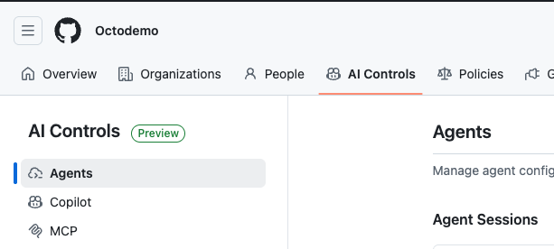
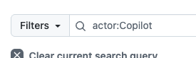
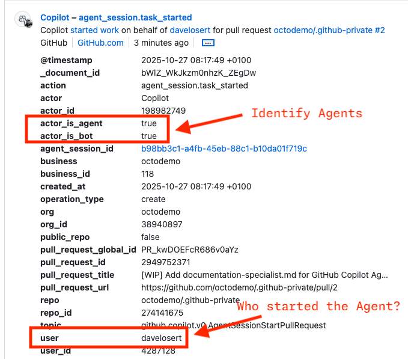
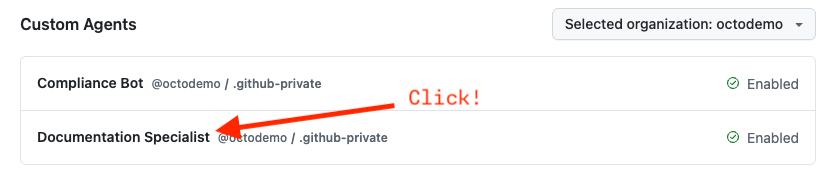
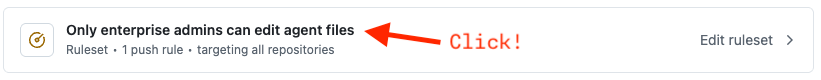
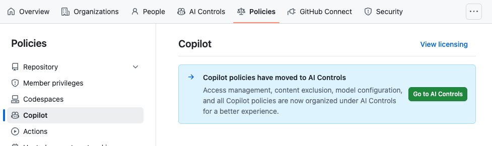

# Governance Features

### Rulesets & Custom Properties

- **id**: walkthrough.governance.rulesets-custom-properties
- **Capabilities:** [Repository Rulesets](../capabilities/governance.md#repository-rulesets) (`capability.repository-rulesets`), [Custom Properties](../capabilities/governance.md#custom-properties) (`capability.custom-properties`)

The repository has an organization ruleset [OD OctoCAT Supply Ruleset](https://github.com/organizations/octobooth-demos/settings/rules) applied, setting up a few of the standard rules like:

1. Protecting the main branch from deletions, force pushes etc.
2. Requiring a pull-request
3. Requiring a CodeQL Scan
4. Requiring the required workflow [Dependency Review](https://github.com/octobooth-demos/octocat-supply-reusable-workflows)

The ruleset is applied through the custom property `od_octocat_supply_risk_tier` with a value of `high`. This custom property is also applied to the demo repositories.

In the demo, there will be a pre-created pr `Feature: Add ToS Download` where some of the rules will be violated. You can demo the effect of rulesets on this PR by showing how the violations are flagged and what the implications are for the development process.

### Copilot Control Plane: GitHub Agents

- **id**: walkthrough.governance.ai-controls-github-agents
- **Capabilities:** [Copilot AI Controls (Control Plane)](../capabilities/governance.md#copilot-ai-controls-control-plane) (`capability.ai-controls`)
- **Prep:** Enterprise admin account required (for GitHub employees: <https://github.com/enterprises/octodemo>). Read-only — do not make any configuration changes.

> [!IMPORTANT]
> **READ-ONLY DEMO**: Given that changing anything in the enterprise settings can be severely disruptive to all organizations and users, please refrain from demoing any configuration changes in this section. This is a read-only demo.

> [!TIP]
> Ideally, you have kicked off your own CCA task before coming here so you can drill down on it in this part.

1. **Installed Agents:**
   1. Navigate to the **Installed Agents** view.
   2. Show that both `Copilot code review` and `Copilot coding agent` are installed for the enterprise.
   3. Show where additional GitHub Agents will appear in the future.
2. **Agent Sessions:**
   1. Navigate to the **Agent Sessions** view.
   2. Show that sessions can be filtered by agent type (`Code Review` or `Coding Agent`) and by specific organizations.
   3. Point out a running session that was kicked off from an issue assignment.

      > [!WARNING]
      > Right now, trying to access anyone's session but your own will lead to a 404 error. This will be fixed in the future.
3. **Copilot Audit Log:**
   1. Finally, navigate to the **Audit Log** via the redirect link.
   2. Show that the log is pre-filtered with `actor:Copilot` to show only AI-related activities.

      

   3. Find and highlight an `agent_session.task` event.
   4. Click on an event and inspect the details to show the new agent-specific fields:
      - `actor_is_agent: true`
      - The `user` field, which shows who the agent is acting on behalf of.

      

### Copilot Control Plane: Custom Agents

- **id**: walkthrough.governance.ai-controls-custom-agents
- **Capabilities:** [Copilot Custom Agents](../capabilities/copilot-general.md#copilot-custom-agents) (`capability.custom-agents`), [Custom Agent Rulesets](../capabilities/governance.md#custom-agent-rulesets) (`capability.custom-agent-rulesets`)
- **Contents:** [Custom agent ruleset](../inventory.md) (`content.custom-agent-ruleset`), [BDD specialist agent](../inventory.md) (`content.bdd-specialist-agent`), [API specialist agent](../inventory.md) (`content.api-specialist-agent`)
- **Prep:** Enterprise admin account required. Read-only — do not make configuration changes.

> [!NOTE]
> This feature will become a multi-select field in the future, so enterprises can select custom agents from more than just one organization.

1. **Setting Up Custom Agents:**
   1. Depending on your enterprise, you will see that the demo organization is pre-selected.
   2. Click on one of the custom agents listed to show the implementation and highlight the `.github-private` repository and its structure, which is the same for every custom agent.
   
2. **Controlling Custom Agent Generation:**
   1. You will see an existing rule for custom agents—click it.
   
   2. If the rule doesn't exist, click once to create it.
   3. Show the supported file path rule for `.github/agents/*.md` across organizations and repositories.
   4. Open the controls for organization, repository, and disablement scope.

> [!TIP]
> We have the rule in `Evaluate` mode for our own demo purposes (we want to allow demoing custom agents across the enterprise). This is still a good example of how the rule can be relaxed.

### Copilot Control Plane: Copilot Policies

- **id**: walkthrough.governance.ai-controls-copilot
- **Capabilities:** [Copilot AI Controls (Control Plane)](../capabilities/governance.md#copilot-ai-controls-control-plane) (`capability.ai-controls`)

1. Open the Copilot section to show the redirect from the previous Copilot policies page to the AI Controls page.

### Copilot Control Plane: MCP Policy Controls

- **id**: walkthrough.governance.ai-controls-mcp
- **Capabilities:** [MCP Policy Controls](../capabilities/governance.md#mcp-policy-controls) (`capability.mcp-policy-controls`)

> [!IMPORTANT]
> Today, the allowlist is only enforced in VS Code. Additional IDEs and GitHub.com support are coming soon.

1. Navigate to the **MCP** section.
2. Highlight the new policy for setting an **MCP allowlist** via a third-party MCP registry.
3. Show the third-party registry URL field used to configure the enterprise-wide MCP allowlist.
