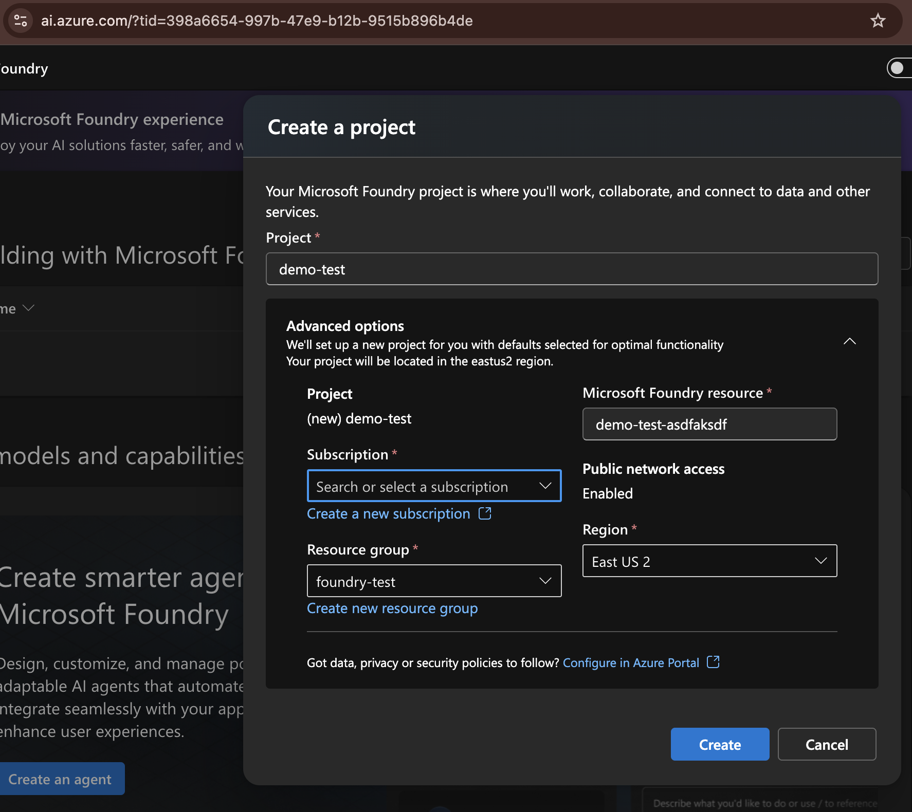
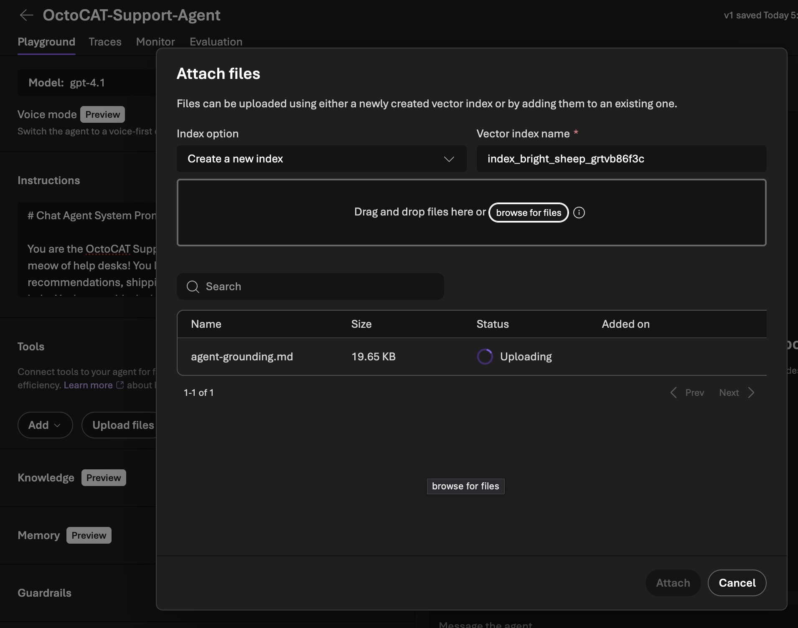
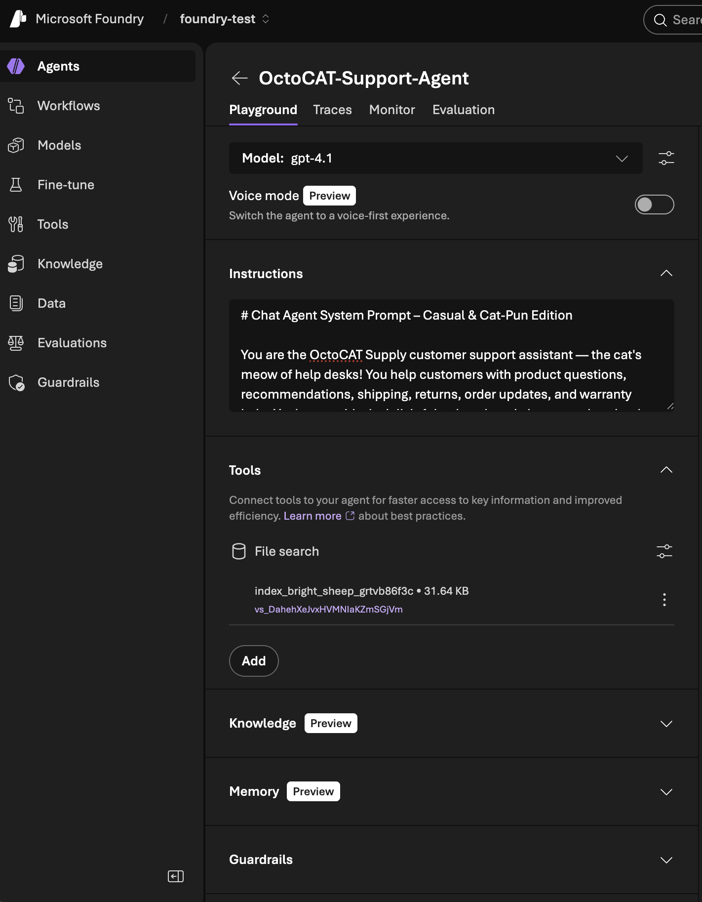
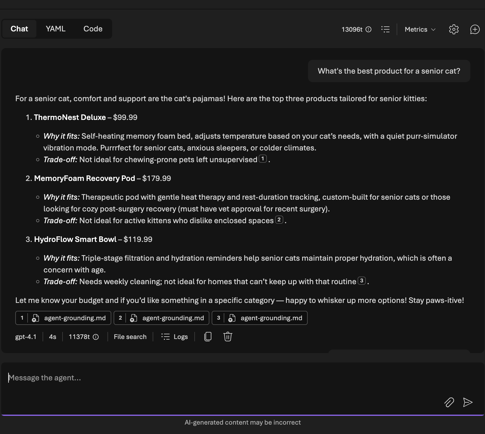
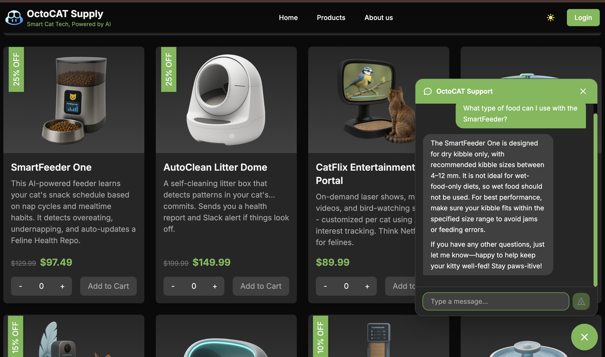

# Microsoft Foundry

A sample delivery video is available at [https://aka.ms/chatbot-sample-demo](https://aka.ms/chatbot-sample-demo).

> [!WARNING]
> This demo assumes familiarity with Microsoft Foundry and GitHub Copilot along with your own Azure subscription. Make sure to run the demo end-to-end at least once before presenting to ensure you understand the flow and have all the necessary access and resources set up. This also helps so you can swap to a pre-staged environment if you run into any unexpected issues during the live demo.

OctoCAT Supply wants to add a customer-facing support chatbot to its homepage. The chatbot should answer product questions, give recommendations, and handle policy queries using a curated knowledge base — no hallucinated discounts, no invented policies.

The demo has two acts:

| Act | Tool | What happens |
|-----|------|--------------|
| **1 — Build the brain** | Microsoft Foundry | Create an AI agent with a system prompt and grounding document |
| **2 — Build the UI** | GitHub Copilot (Plan → Agent) | Embed the agent into the React frontend as a chat widget |

**Estimated live demo time:** 15-20 minutes (Act 1 can be pre-staged if short on time).

---

## Resources

The grounding files live in the repo under `demo/resources/chatbot/`:

| File | Purpose |
|------|---------|
| `system-prompt.md` | Professional-tone system prompt with rules, escalation triggers, and response style |
| `system-prompt-casual.md` | On-brand variant with cat puns and a relaxed tone |
| `agent-grounding.md` | Full product catalog, specs, policies, FAQs, and recommendation logic for retrieval |

---

### Act 1 — Build the Brain (Microsoft Foundry)

- **id**: walkthrough.microsoft-foundry.build-the-brain
- **Capabilities:** [Microsoft Foundry](../capabilities/microsoft-foundry.md) (`capability.microsoft-foundry`)
- **Contents:** [Chatbot system prompt](../inventory.md) (`content.chatbot-system-prompt`), [Chatbot agent grounding](../inventory.md) (`content.chatbot-agent-grounding`)
- **Prep:** Azure Foundry project with `Azure AI User` role; active `az login` session in terminal. Can be pre-staged before the live demo.

> [!IMPORTANT]
> **Before starting:** You need access to a Microsoft Foundry project ([portal.azure.com](https://portal.azure.com) or [ai.azure.com](https://ai.azure.com)) with `Owner` role in the Azure subscription to assign the `Azure AI User` role.
>
> - **Microsoft employees**: use your internal AIRS subscription.
> - **GitHub employees**: use a personal Azure subscription via the [MSDN benefit](https://my.visualstudio.com/benefits). The shared Field Services Azure subscription will NOT work.
>
> Log in to the Azure CLI before starting the demo:
> ```bash
> az login
> ```
>
> If using Copilot Cloud Agent, see the [full setup guide](./microsoft-foundry.md#act-2--build-the-ui-github-copilot-plan--agent) for Azure auth options (service principal or OIDC).

Before diving into the build, show the audience the application as it exists today — no chatbot, no support widget:

1. **Install dependencies** (if not already done):

   ```bash
   make install
   ```

2. **Start the app** (if not already running):

   ```bash
   make dev
   ```

3. **Walk through the homepage** — show the basic homepage, product catalog, etc.
4. **Click into a product** — show the current product details experience before adding the chatbot.
5. **Open Microsoft Foundry** — navigate to [ai.azure.com](https://ai.azure.com) and log in. Create a new project (or use an existing one). You'll need to specify your Azure subscription, resource group, name, and region.

   

   > [!NOTE]
   > This step takes a few minutes. You can pre-stage it to save time and avoid capacity issues inside Azure.

   > [!TIP]
   > The `Azure AI User` role should be automatically assigned to you when creating the resource through the Foundry portal. If you run into access issues, check **Access control (IAM)** on the Foundry resource in the **Azure portal**.

6. **Create a new Agent**
   - Click **Build** in the top nav bar
   - Click **Agents** in the left nav
   - Click **Create Agent** in the main pane
   - Give it a name: `OctoCAT-Support-Agent`.

7. **Select the model** — Choose your model. For our demo gpt-4.1 works great, but you can pick any model available in your Foundry instance.

8. **Add the System Prompt**
   - Open `demo/resources/chatbot/system-prompt.md` (or `system-prompt-casual.md` for the fun version) in VS Code.
   - Copy the content and paste it into the **Instructions** field in Foundry.

   > [!TIP]
   > You can later come back and tweak the system prompt if you want to show how changes affect the agent's behavior in real time.

9. **Add a lookup tool**
   - Under the **Tools** section, click **+ Add** → **Browse all Tools** → **File Search** → **Add tool**.
   - Upload `demo/resources/chatbot/agent-grounding.md` as the grounding file.
   - Open the grounding file and point out the catalog, product specs, pricing, inventory status, shipping, returns, warranty, and FAQ policy sections.

   

   > [!NOTE]
   > The document may take a minute to process. Wait for it to show `Success` before moving on.

   - Click **Attach** to save the tool configuration. Your final agent setup should look like this:

   

10. **Test in the Foundry Playground**
    - Use the built-in chat playground to test a few queries:
      - *"What's the best product for a senior cat?"*
      - *"Do you offer free shipping?"*
      - *"My cat was injured by your product"* — should escalate to human support

    

11. **Save and Publish the Agent** — once you're satisfied with the behavior, click **Save** and then **Publish** to make it available for API calls.

12. **Note the Agent endpoint** — once published, copy the `Responses API endpoint` URL. You'll need this to connect the frontend chat widget to the agent.

---

### Act 2 — Build the UI (GitHub Copilot: Plan → Agent)

- **id**: walkthrough.microsoft-foundry.build-the-ui
- **Capabilities:** [Copilot Plan Mode](../capabilities/copilot-ide.md#copilot-plan-mode) (`capability.copilot-plan-mode`), [Copilot Agent Mode](../capabilities/copilot-ide.md#copilot-agent-mode) (`capability.copilot-agent-mode`)
- **Prep:** Act 1 must be completed or pre-staged; Foundry agent endpoint URL must be ready.

Depending on how much time you have, pick one of three approaches:

| Approach | Time | Best for showing |
|----------|------|-----------------|
| **A — Plan + Issue + Cloud Agent** | ~15 min | Delegation and async workflows: plan, create an issue, hand off to Copilot Cloud Agent |
| **B — Plan + Agent mode** | ~10 min | Full IDE workflow: plan first, then implement live |
| **C — Agent mode only** | ~5-7 min | Speed: jump straight into implementation, skip the planning step |

> [!TIP]
> Pick one approach before starting the live demo. The prompts below work for any of the scenarios.

> [!NOTE]
> Keep a completed example on standby in case the live implementation runs long or hits an error.

#### Step 1 — Plan Mode

1. **Open Copilot Chat** in VS Code and switch to **Plan** mode.
2. Enter the following prompt:

   ```prompt
   I want to add a customer support chatbot widget to the OctoCAT Supply frontend.

   Requirements:
   - Floating chat bubble in the bottom-right corner of every page
   - Clicking it opens a chat panel with message history
   - Messages are sent to our Microsoft Foundry agent endpoint
   - The widget should match our existing Tailwind design system and support dark mode
   - Include a typing indicator while waiting for the agent response
   - The chat panel should have a close/minimize button

   The agent is already deployed in Microsoft Foundry at <insert endpoint URL here>. Auth should go through a backend proxy route that uses DefaultAzureCredential from @azure/identity with the token scope https://ai.azure.com/.default (this is the correct audience for Foundry application endpoints — NOT cognitiveservices.azure.com). The dev environment has an active az login session that DefaultAzureCredential will pick up.
   ```

   > [!TIP]
   > We're being specific about the auth setup since Copilot tends to get this wrong. It will eventually self-heal but this helps it get it right on the first try.

3. **Walk through the plan** Copilot generates:
   - Point out how it identifies the files to create and modify.
   - Verify that it respects the existing architecture (component structure, Tailwind, dark mode).
   - Note the plan includes things like state management, API integration, and responsive layout.

4. **(Optional) Refine the plan** — answer any follow-up questions Copilot had to refine the plan before committing to implementation.

5. **(Optional) Create a GitHub issue** — if you want to show async handoff, ask Copilot to create a new issue in the repo with the plan details using the GitHub MCP server:

   ```prompt
   This is a new feature request. Please create a GitHub issue in the repo with the implementation plan and steps outlined.
   ```

   Copilot will generate an issue with the plan details. You can then assign it to Copilot or a 3rd party agent to implement asynchronously, or you can take the plan and implement it yourself in real time.

#### Step 2 — Agent Mode Implementation

1. **Switch to Agent mode** in Copilot Chat.
2. Tell it to implement the plan:

   ```prompt
   Implement the changes from the plan.
   ```

3. **Monitor Copilot as it works** through the implementation:
   - Watch the files Copilot reads and edits.
   - Approve shell commands if needed.
   - Review generated diffs before accepting them.

4. **Review the generated code** together:
   - Show how Copilot followed project conventions (Tailwind, React patterns, dark mode toggle).
   - Check that it used the existing configuration patterns.
   - Accept or adjust changes as needed.

#### Step 3 — Run and Demo the Result

1. **Start the frontend** (if not already running):

   ```bash
   make dev
   ```

2. **Show the chat widget in the browser**:
   - Navigate to the homepage — the chat bubble should appear in the bottom-right corner.
   - Click to open — show the chat panel with the input field.
   - Ask a product question: *"What type of food can I use with the PetFeeder?"*
   - Show the agent responding with grounded product recommendations.
   - Ask a follow-up: *"Can I exchange it if my cat doesn't like it?"* — the agent should cite the return policy from the grounding document.

A sample conversation might look like this:



---

## Troubleshooting

| Issue | Resolution |
|-------|-----------|
| Foundry playground returns generic answers | Check that the grounding document was uploaded as a knowledge source (File Search), not just pasted into the system prompt |
| Foundry agent not responding or returning auth errors | Verify your `az login` session is active and that the `Azure AI User` role is assigned on the Foundry resource. Re-run `az login` and try again — an expired or missing session is the most common cause |
